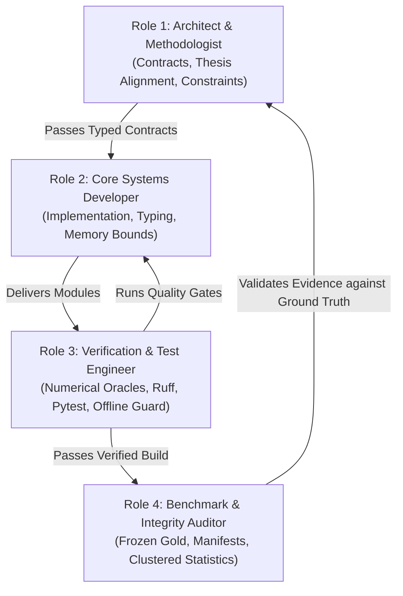

# Agent Roles, Orchestration & Feedback Loops
**Target Repository:** `local-subtitle-workbench`  
**Framework:** Autonomous Multi-Agent Development & Verification Loop

---

## 1. Multi-Agent Role Architecture

To maintain rigorous separation of concerns and prevent confirmation bias, development and evaluation in this repository are partitioned across 4 distinct agentic roles:



---

## 2. Role Specifications & Responsibilities

### Role 1: Architect & Methodologist
- **Primary Goal:** Maintain strict alignment with the Master's Thesis Individual Plan and academic literature.
- **Key Responsibilities:**
  - Define input/output data contracts (`models.py`).
  - Maintain and update [`docs/ARCHITECTURE.md`](file:///C:/Users/nurym/Desktop/local-subtitle-workbench/docs/ARCHITECTURE.md) and [`docs/KNOWLEDGE_BASE.md`](file:///C:/Users/nurym/Desktop/local-subtitle-workbench/docs/KNOWLEDGE_BASE.md).
  - Enforce hardware constraints (Ryzen 9 5900HX, RTX 3050 Laptop 4GB).
  - Reject out-of-scope feature creep (TTS, visual analysis, LLM summaries).

### Role 2: Core Systems Developer
- **Primary Goal:** Implement modular, high-performance Python code conforming to the 5 ASDP Quality Gates.
- **Key Responsibilities:**
  - Implement single-responsibility modules in `src/subtitle_workbench/`.
  - Maintain explicit sequential execution and VRAM deallocation (`torch.cuda.empty_cache()`).
  - Implement zero-overhead adapters (e.g., `mfa_wrapper.py`) and PyTorch CTC fallbacks.

### Role 3: Verification & Test Engineer
- **Primary Goal:** Guarantee zero regressions, deterministic mathematics, and distributable packaging.
- **Key Responsibilities:**
  - Implement numerical unit tests, edge-case tests, and contract validation in `tests/`.
  - Run continuous automated verification gates (`ruff check`, `ruff format --check`, `pytest`).
  - Verify package builds (`python -m build --wheel --no-isolation`) and execute offline socket-blocked smoke tests.

### Role 4: Benchmark & Integrity Auditor
- **Primary Goal:** Enforce the Anti-Falsification Policy and ensure reproducible scientific evaluation.
- **Key Responsibilities:**
  - Audit corpus usage against [`docs/CORPORA_TAXONOMY.md`](file:///C:/Users/nurym/Desktop/local-subtitle-workbench/docs/CORPORA_TAXONOMY.md).
  - Enforce the `UNMEASURED / PENDING_EXPERIMENT` rule on unexecuted benchmarks.
  - Compute Clustered Bootstrap 95% Confidence Intervals and Paired Wilcoxon Signed-Rank statistics.
  - Verify SHA-256 digests in output `manifest.json` files.

---

## 3. The Autonomous Execution & Feedback Loop

Every development step follows the closed feedback loop:

```
                  THE CLOSED FEEDBACK LOOP
  ┌────────────────────────────────────────────────────────┐
  │ 1. Spec Gate: Contract & Bounds defined in models.py   │
  └───────────────────────────┬────────────────────────────┘
                              ▼
  ┌────────────────────────────────────────────────────────┐
  │ 2. Dev Gate: Code implemented in src/subtitle_workbench │
  └───────────────────────────┬────────────────────────────┘
                              ▼
  ┌────────────────────────────────────────────────────────┐
  │ 3. Test Gate: pytest + ruff lint execution             │
  └───────────────────────────┬────────────────────────────┘
                              ▼
           [Did all tests pass with zero warnings?]
             ├── NO  ──► Fix bug / error (Loop back to Dev)
             └── YES ──► Continue
                              ▼
  ┌────────────────────────────────────────────────────────┐
  │ 4. Build Gate: Wheel build & offline socket smoke test │
  └───────────────────────────┬────────────────────────────┘
                              ▼
  ┌────────────────────────────────────────────────────────┐
  │ 5. Audit Gate: manifest.json validation & Git commit   │
  └────────────────────────────────────────────────────────┘
```
