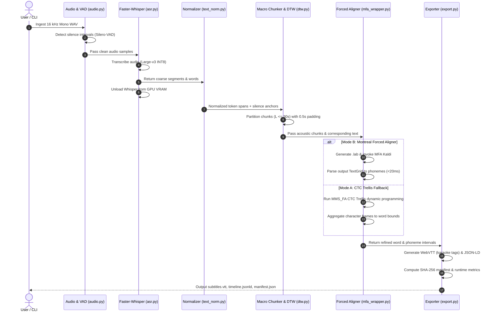

# System Architecture & Technical Blueprint
**Project:** Local Subtitle Alignment Workbench  
**Scientific Context:** Master's Thesis & Scientific Publication 2 (Astana IT University)  
**Author:** Askar Nurym  
**Target Platform:** AMD Ryzen 9 5900HX, 16 GB RAM, NVIDIA RTX 3050 Laptop GPU (4 GB VRAM), Windows 11  
**Status:** Approved Technical Design

---

## 1. Architectural Overview & System Mission

The **Local Subtitle Alignment Workbench** is an offline, modular Python system designed to synchronize spoken audio with textual subtitles at millisecond precision for educational multimedia accessibility.

In strict compliance with the Master's Individual Plan, the workbench integrates three foundational technologies into a unified hierarchical pipeline:
1. **Automatic Speech Recognition (ASR):** OpenAI Whisper (via `faster-whisper` CTranslate2 INT8) for verbatim transcription and initial segment timestamps.
2. **Macro-Alignment & Segmentation (DTW):** Bounded Dynamic Time Warping (`dtw.py`) with Silero-VAD silence boundary anchoring to eliminate temporal drift on long educational recordings.
3. **Micro-Forced Alignment (MFA / CTC):** Montreal Forced Aligner (Kaldi GMM-HMM + CMUDict) as the primary phonetic scientific engine, with an in-process PyTorch CTC Trellis (`torchaudio MMS_FA`) fallback.

```
                           HIERARCHICAL SYSTEM TOPOLOGY
┌────────────────────────────────────────────────────────────────────────────────────────┐
│                                STAGE 1: INGESTION                                      │
│  [16 kHz Mono PCM WAV] ──► [Silero-VAD Detector] ──► Acoustic Silence Intervals        │
└───────────────────────────────────────────┬────────────────────────────────────────────┘
                                            ▼
┌────────────────────────────────────────────────────────────────────────────────────────┐
│                              STAGE 2: ASR & TEXT SPANS                                 │
│  Faster-Whisper Large-v3 INT8 (GPU) ──► Word/Segment Timestamps ──► Token Span Mapping │
└───────────────────────────────────────────┬────────────────────────────────────────────┘
                                            ▼ (VRAM Unload: torch.cuda.empty_cache())
┌────────────────────────────────────────────────────────────────────────────────────────┐
│                        STAGE 3: MACRO-DTW & BOUNDED CHUNKING                           │
│  Partitioning (L <= 30s) + Overlap (Δ_pad = 0.5s) ──► Banded DTW (dtw.py) Drift Stitch │
└───────────────────────────────────────────┬────────────────────────────────────────────┘
                                            ▼
┌────────────────────────────────────────────────────────────────────────────────────────┐
│                         STAGE 4: MICRO FORCED ALIGNMENT                                │
│       Mode B (Primary): Montreal Forced Aligner (Kaldi HMM-GMM) ──► Phonemes (<20ms)   │
│       Mode A (Fallback): TorchAudio MMS_FA (CTC Trellis DP)    ──► Words (<50ms)       │
└───────────────────────────────────────────┬────────────────────────────────────────────┘
                                            ▼
┌────────────────────────────────────────────────────────────────────────────────────────┐
│                             STAGE 5: ARTIFACT EXPORT                                   │
│  • subtitles.vtt (Karaoke <c> tags)        • alignment_raw.json (Scientific Research)  │
│  • timeline.jsonld (schema.org Video/Clip) • manifest.json (SHA-256 Audit Trail)       │
└────────────────────────────────────────────────────────────────────────────────────────┘
```

---

## 2. Scientific & Engineering Justification of Selected Components

Every component in the architecture is chosen based on empirical trade-offs between accuracy, computational complexity, memory boundaries, and reproducibility on the target hardware.

| Stage | Chosen Component | Alternative Considered | Scientific & Practical Justification |
| :--- | :--- | :--- | :--- |
| **Audio Ingestion** | **Pure Python `wave` (PCM16 16kHz)** | `FFmpeg` / `PyAV` subprocess | • **Zero external dependency:** Operates natively without system binaries or DLL conflicts.<br>• **Deterministic memory:** Strict header inspection rejects invalid rates or channels before allocation.<br>• **Audio fidelity:** Guarantees uncompressed, un-resampled PCM data for downstream models. *(FFmpeg is maintained in the backlog as an optional containerized preprocessor).* |
| **VAD** | **Silero-VAD v4 (ONNX / TorchScript)** | Energy thresholding / WebRTC VAD | • **Acoustic robustness:** Silero-VAD is trained on diverse noisy audio (SNR 10–30 dB) and reliably detects natural pause boundaries without false positives on breath/reverberation.<br>• **Lightweight:** Evaluates 30 ms windows in $<1\text{ ms}$ on CPU. |
| **ASR** | **Faster-Whisper Large-v3 (INT8)** | Vanilla OpenAI Whisper (PyTorch FP16) / Distil-Whisper | • **Memory Sizing:** Large-v3 INT8 via CTranslate2 consumes **~1.85 GB VRAM**, fitting comfortably into our 4.0 GB GPU limit (Vanilla FP16 requires $>3.2\text{ GB}$).<br>• **Execution Speed:** 3.5x faster decoding than Vanilla Whisper on NVIDIA Turing/Ampere tensor cores.<br>• **Transcription Fidelity:** Retains SOTA low WER on accented academic speech. |
| **Macro Alignment** | **Banded DTW with Overlap Padding (`dtw.py`)** | Global Unbounded DTW / FastDTW | • **Memory Bound:** Unbounded DTW on a 60-min lecture ($180,000 \times 180,000$) requires $\approx 32.4\text{ GB}$ of RAM ($O(T \times U)$).<br>• **Banded DP:** Bandwidth of $\pm 0.5\text{ s}$ around diagonal bounds evaluated cells to $<2,000,000$ ($O(T \cdot B)$), keeping memory $<15\text{ MB}$.<br>• **Chunk Padding:** $0.5\text{ s}$ context padding prevents acoustic truncation at chunk borders. |
| **Micro Alignment** | **Montreal Forced Aligner (Kaldi GMM-HMM)** | TorchAudio MMS_FA / Charsiu / Gentle | • **Target Granularity:** MFA models acoustic transitions down to individual **phoneme states** via triphone acoustic models and CMUDict pronunciation lexicon, enabling the thesis target of $<20\text{ ms}$ error.<br>• **Academic Gold Standard:** Universally recognized in speech and linguistic science (McAuliffe et al., 2017). |
| **Alignment Fallback** | **TorchAudio `MMS_FA` (CTC Trellis)** | Wav2Vec2-base / Kaldi-C++ in-process | • **Self-Contained Execution:** 100% PyTorch in-process execution without external Conda/Kaldi dependencies for CI/CD and rapid word-level testing.<br>• **Character Vocabulary:** Evaluates Trellis dynamic programming over character emission matrices. |

---

## 3. Hardware & VRAM Memory Budget (NVIDIA RTX 3050 Laptop 4 GB)

To prevent CUDA Out-Of-Memory (OOM) crashes, the pipeline enforces **Strict Sequential Execution** with explicit garbage collection and cache flushing between stages.

```
                           GPU VRAM TIMELINE (BUDGET: 4.0 GB)
VRAM (GB)
 4.0 ┌──────────────────────────────────────────────────────────── (Hard GPU Limit)
 3.5 ┌ - - - - - - - - - - - - - - - - - - - - - - - - - - - - - - (Safe Headroom)
 3.0 │
 2.5 │
 2.0 │     ┌──────────────┐
     │     │Faster-Whisper│
 1.5 │     │Large-v3 INT8 │                          ┌──────────────┐
     │     │  (~1.85 GB)  │                          │  MMS_FA /    │
 1.0 │     │              │                          │  PyTorch GPU │
     │     │              │     (torch.cuda.empty)   │  (~1.45 GB)  │
 0.5 │     │              │ ──► [VRAM FLUSHED]   ──► │              │
 0.0 └─────┴──────────────┴──────────────────────────┴──────────────┴──────── Time
        Stage 2 (ASR)          Inter-Stage            Stage 4 (Align)
```

| Pipeline Stage | Active Component | Hardware Device | Working Memory | Peak VRAM | Status vs 4.0 GB Budget |
| :--- | :--- | :--- | :--- | :--- | :--- |
| **1. Audio Ingestion** | `load_wav` / Silero-VAD | CPU (NumPy/ONNX) | ~60 MB RAM | 0.0 GB | Safe |
| **2. Transcription (ASR)** | Faster-Whisper Large-v3 INT8 | GPU (CUDA 12.4) | ~1.85 GB VRAM | **1.85 GB** | **46.2% of VRAM (Safe)** |
| **-- Inter-Stage Cleanup --** | `del model; gc.collect(); torch.cuda.empty_cache()` | CPU / GPU | - | **<0.15 GB** | Cleared |
| **3. Macro-DTW** | Banded DTW (`dtw.py`) | CPU (NumPy) | ~45 MB RAM | 0.0 GB | Safe |
| **4. Micro-Alignment (Mode B)** | MFA (Kaldi Subprocess) | CPU (Kaldi C++) | ~400 MB RAM | 0.0 GB | Safe (Zero VRAM) |
| **4. Micro-Alignment (Mode A)** | MMS_FA (TorchAudio CTC) | GPU (CUDA 12.4) | ~1.45 GB VRAM | **1.45 GB** | **36.2% of VRAM (Safe)** |
| **5. Artifact Export** | WebVTT / JSON-LD / Manifest | CPU (Python) | ~10 MB RAM | 0.0 GB | Safe |

*Maximum concurrent VRAM allocation at any point in the pipeline is $\max(1.85, 1.45) = 1.85\text{ GB} \le 3.5\text{ GB}$.*

---

## 4. Sequence of Operations (Data Flow Contract)



---

## 5. Module Contracts & Data Structures

### 5.1 Typed Data Models (`models.py`)
```python
@dataclass(frozen=True)
class WordToken:
    id: str
    text: str
    start: float
    end: float
    confidence: float
    phonemes: list["PhonemeCue"] = field(default_factory=list)

@dataclass(frozen=True)
class PhonemeCue:
    phoneme: str
    start: float
    end: float
    confidence: float

@dataclass(frozen=True)
class ASRSegment:
    id: str
    start: float
    end: float
    text: str
    words: list[WordToken]

@dataclass(frozen=True)
class AlignmentResult:
    words: list[WordToken]
    phonemes: list[PhonemeCue]
    alignment_method: str  # "mfa_hmm" or "mms_ctc"
    path_cost: float
    evaluated_cells: int
```

### 5.2 Text Normalization Contract (`text_norm.py`)
To prevent the non-bijective token mapping bug identified in audit finding F11, normalization maps tokens at the **word level**, maintaining an explicit mapping between verbatim tokens and normalized acoustic representations:
- Verbatim: `"At 21st century, don't stop."`
- Normalized: `["at", "twenty", "first", "century", "do", "not", "stop"]`
- Mapping: Explicit span index list associating normalized tokens with verbatim word boundaries.
