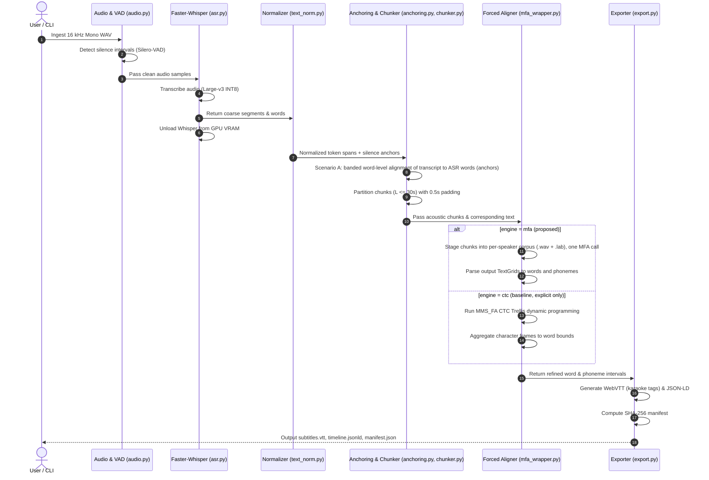

# System Architecture & Technical Blueprint
**Project:** Local Subtitle Alignment Workbench  
**Scientific Context:** Master's Thesis & Scientific Publication 2 (Astana IT University)  
**Author:** Askar Nurym  
**Target Platform:** AMD Ryzen 9 5900HX, 16 GB RAM, NVIDIA RTX 3050 Laptop GPU (4 GB VRAM), Windows 11  
**Status:** Approved Technical Design

---

## 1. Architectural Overview & System Mission

The **Local Subtitle Alignment Workbench** is an offline, modular Python system designed to synchronize spoken audio with textual subtitles at millisecond precision for educational multimedia accessibility.

In strict compliance with the Master's Individual Plan, the workbench integrates three foundational technologies into a unified hierarchical pipeline:
1. **Automatic Speech Recognition (ASR):** OpenAI Whisper (via `faster-whisper` CTranslate2 INT8) for verbatim transcription and initial segment timestamps.
2. **Macro-Alignment & Segmentation ("downsample-then-align"):** a known transcript is first aligned to the Whisper words by a banded monotonic dynamic-programming alignment over word tokens (`anchoring.py`; a DTW-style path at word resolution), then cut into pause-anchored chunks using Silero-VAD. The separate acoustic banded DTW (`dtw.py`) serves the audio-to-audio timing-transfer tool (`align-dtw`).
3. **Forced Alignment:** Montreal Forced Aligner (Kaldi GMM-HMM) is the engine of the proposed pipeline; torchaudio `MMS_FA` (CTC trellis) is a baseline. The engine is always chosen explicitly; there is no automatic fallback between engines.

```
                           HIERARCHICAL SYSTEM TOPOLOGY
┌────────────────────────────────────────────────────────────────────────────────────────┐
│                                STAGE 1: INGESTION                                      │
│  [16 kHz Mono PCM WAV] ──► [Silero-VAD Detector] ──► Acoustic Silence Intervals        │
└───────────────────────────────────────────┬────────────────────────────────────────────┘
                                            ▼
┌────────────────────────────────────────────────────────────────────────────────────────┐
│                              STAGE 2: ASR & TEXT SPANS                                 │
│  Faster-Whisper Large-v3 INT8 (GPU) ──► Word/Segment Timestamps ──► Token Span Mapping │
└───────────────────────────────────────────┬────────────────────────────────────────────┘
                                            ▼ (VRAM Unload: torch.cuda.empty_cache())
┌────────────────────────────────────────────────────────────────────────────────────────┐
│                 STAGE 3: TRANSCRIPT ANCHORING & BOUNDED CHUNKING                       │
│  Word-level banded DP (anchoring.py) ──► Chunks L <= 30 s, overlap 0.5 s (chunker.py)  │
└───────────────────────────────────────────┬────────────────────────────────────────────┘
                                            ▼
┌────────────────────────────────────────────────────────────────────────────────────────┐
│                         STAGE 4: FORCED ALIGNMENT (PHONETIC & WORD)            │
│       Proposed: Montreal Forced Aligner, one batch call ──► Words + Phonemes          │
│       Baseline: TorchAudio MMS_FA (CTC Trellis DP)      ──► Words                     │
└───────────────────────────────────────────┬────────────────────────────────────────────┘
                                            ▼
┌────────────────────────────────────────────────────────────────────────────────────────┐
│                             STAGE 5: ARTIFACT EXPORT                                   │
│  • subtitles.vtt (Karaoke <c> tags)        • alignment_raw.json (Scientific Research)  │
│  • timeline.jsonld (schema.org Video/Clip) • manifest.json (SHA-256 Audit Trail)       │
└────────────────────────────────────────────────────────────────────────────────────────┘
```

---

## 2. Scientific & Engineering Justification of Selected Components

Every component in the architecture is chosen based on empirical trade-offs between accuracy, computational complexity, memory boundaries, and reproducibility on the target hardware.

| Stage | Chosen Component | Alternative Considered | Scientific & Practical Justification |
| :--- | :--- | :--- | :--- |
| **Audio Ingestion** | **Pure Python `wave` (PCM16 16kHz)** | `FFmpeg` / `PyAV` subprocess | • **Zero external dependency:** Operates natively without system binaries or DLL conflicts.<br>• **Deterministic memory:** Strict header inspection rejects invalid rates or channels before allocation.<br>• **Audio fidelity:** Guarantees uncompressed, un-resampled PCM data for downstream models. *(FFmpeg is maintained in the backlog as an optional containerized preprocessor).* |
| **VAD** | **Silero-VAD v4 (ONNX / TorchScript)** | Energy thresholding / WebRTC VAD | • **Acoustic robustness:** Silero-VAD is trained on diverse noisy audio (SNR 10–30 dB) and reliably detects natural pause boundaries without false positives on breath/reverberation.<br>• **Lightweight:** Evaluates 30 ms windows in $<1\text{ ms}$ on CPU. |
| **ASR** | **Faster-Whisper Large-v3 (INT8)** | Vanilla Whisper / Distil-Whisper / whisper.cpp / NeMo Parakeet-TDT | • **Memory Sizing:** Large-v3 INT8 via CTranslate2 fits into the 4.0 GB GPU of the target laptop, whereas vanilla FP16 does not.<br>• **Transcription Fidelity:** Retains SOTA low WER on accented academic speech.<br>• **Accessibility Alternatives:** `whisper.cpp` provides pure-CPU offline fallback for low-resource student laptops without dedicated GPUs; `Parakeet-TDT` provides a non-autoregressive Transducer benchmark in the analogs backlog. |
| **Macro Alignment** | **Banded DTW with Overlap Padding (`dtw.py`)** | Global Unbounded DTW / FastDTW | • **Memory Bound:** Unbounded DTW on a 60-min lecture ($180,000 \times 180,000$) requires $\approx 32.4\text{ GB}$ of RAM ($O(T \times U)$).<br>• **Banded DP:** Bandwidth of $\pm 0.5\text{ s}$ around diagonal bounds evaluated cells to $<2,000,000$ ($O(T \cdot B)$), keeping memory $<15\text{ MB}$.<br>• **Chunk Padding:** $0.5\text{ s}$ context padding prevents acoustic truncation at chunk borders. |
| **Forced Alignment** | **Montreal Forced Aligner (Kaldi GMM-HMM)** | TorchAudio MMS_FA / Charsiu / Gentle | • **Target Granularity:** MFA models acoustic transitions down to individual **phoneme states** via triphone acoustic models and CMUDict pronunciation lexicon, enabling the thesis target of $<20\text{ ms}$ error.<br>• **Academic Gold Standard:** Universally recognized in speech and linguistic science (McAuliffe et al., 2017). |
| **Alignment Baseline** | **TorchAudio `MMS_FA` (CTC Trellis)** | Wav2Vec2-base / Kaldi-C++ in-process | • **Self-Contained Execution:** 100% PyTorch in-process execution without external Conda/Kaldi dependencies for CI/CD and rapid word-level testing.<br>• **Character Vocabulary:** Evaluates Trellis dynamic programming over character emission matrices. |

### 2.1 Montreal Forced Aligner (MFA) Operational Architecture & Windows 11 Toolchain

In speech science, Montreal Forced Aligner (McAuliffe et al., Interspeech 2017) is an open-source orchestration tool around compiled **Kaldi C++ binaries** (`compute-mfcc-feats`, `compile-train-graphs`, `gmm-align-compiled`) using GMM-HMM acoustic models and the CMUDict pronunciation lexicon.

Two critical architectural decisions govern MFA in this workbench:
1. **External CLI Integration (No PyPI Dependency):**  
   Kaldi C++ binaries and OpenFST DLLs on Windows 11 are distributed via `conda-forge`. MFA **cannot** be packaged as a direct wheel in `pyproject.toml` (which uses Python 3.12 with `uv`). The workbench interfaces with MFA as an external CLI tool (`mfa.exe`) via `subprocess.run`; if MFA is requested but missing, the run stops with an error.
2. **Corpus Staging Batch Architecture (Overhead Prevention):**  
   Each invocation of `mfa align` incurs 10–15 seconds of process startup latency (Python CLI bootstrap, SQLite dictionary cache, Kaldi initialization). Spawning MFA per 30-second chunk in a loop would introduce disastrous overhead (50 chunks $\times$ 12s = 600s). The workbench stages all audio chunks into a temporary corpus directory (`temp/mfa_staging_<uuid>/corpus/chunk_0000.wav`, `.lab`), executes `mfa align` **once per batch** (one lecture, or every utterance of a benchmark run, grouped into per-speaker directories so that MFA performs speaker adaptation), and parses the resulting Praat `.TextGrid` files. Out-of-vocabulary words are pronounced with `--g2p_model_path`, and `--fine_tune` refines boundaries below the 10 ms frame shift.
3. **Tripartite Dual-Engine Coexistence:**  
   - **Mode B (MFA):** Primary scientific benchmark fulfilling the AITU Master's Individual Plan for sub-20ms phoneme boundaries.  
   - **Mode A (MMS_FA CTC Trellis):** In-process PyTorch baseline, used only when explicitly selected.  
   - **Publication 2:** The direct empirical benchmark comparing Kaldi GMM-HMM vs Neural CTC Trellis on accented educational speech forms the core experimental contribution for the *Scientific Journal of Astana IT University*.

### 2.2 Out-Of-Vocabulary (OOV) Academic Lexicon Mitigation
In university lectures, instructors frequently employ specialized academic terminology (*backpropagation, quaternion, eigenvalues, kubernetes, polymorphism*) absent from standard pronunciation lexicons like CMUDict (~134k words).
- **MFA G2P Generation:** `mfa align --g2p_model_path english_us_arpa` generates pronunciations for out-of-vocabulary words during alignment.
- **CTC Immunity:** The CTC baseline (`torchaudio MMS_FA`) maps acoustic frames directly to a character-level alphabet (`[a-z|']`), rendering it inherently 100% immune to dictionary OOV failures.

### 2.3 Discretization Limits: CTC 20ms Frame Stride vs Continuous Triphone HMMs
- **MMS_FA (Wav2Vec2) Stride:** The convolutional feature extractor downsamples 16 kHz audio by 320 samples ($16000 / 320 = 50\text{ Hz}$), resulting in a discrete frame resolution of exactly **20.0 ms**. Without continuous sub-frame interpolation, CTC Trellis boundary placements are discretized to 20 ms intervals.
- **MFA (Kaldi) Continuous Transitions:** Montreal Forced Aligner extracts MFCC features at a 10 ms hop rate (100 Hz) with continuous triphone HMM forward-backward transitions down to sub-frame states. This provides the mathematical capability required to reliably achieve sub-20ms boundary precision ($\text{Acc}@20\text{ms} \ge 85\%$) on acoustic benchmarks.

### 2.4 Audio Duration & 32-bit RIFF/WAV Header Boundaries
- Standard 32-bit RIFF/WAV headers represent data byte lengths as an unsigned 32-bit integer, capping file size at $2^{32} - 1 \approx 4.29\text{ GB}$ (equivalent to $\approx 37.2\text{ hours}$ of 16 kHz 16-bit mono PCM).
- The pipeline's Stage 4 macro-chunker partitions audio into $L \le 30.0\text{ s}$ slices and streams raw byte frames via `slice_wav`, ensuring linear memory complexity $O(N)$ and preventing memory spikes or integer overflow on long lecture recordings.

---

## 3. Hardware Constraint (NVIDIA RTX 3050 Laptop, 4 GB)

To prevent CUDA Out-Of-Memory crashes on a 4 GB laptop GPU, neural models run **strictly sequentially**: Faster-Whisper is unloaded (`del model; gc.collect(); torch.cuda.empty_cache()`) before the CTC aligner is loaded. MFA (Kaldi) runs on CPU. This is an engineering constraint, not an evaluation metric.

---

## 4. Sequence of Operations (Data Flow Contract)



---

## 5. Module Contracts & Data Structures

### 5.1 Typed Data Models (`models.py`)
```python
@dataclass(frozen=True)
class WordToken:
    id: str
    text: str
    start: float
    end: float
    confidence: float
    phonemes: list["PhonemeCue"] = field(default_factory=list)


@dataclass(frozen=True)
class PhonemeCue:
    phoneme: str
    start: float
    end: float
    confidence: float


@dataclass(frozen=True)
class ASRSegment:
    id: str
    start: float
    end: float
    text: str
    words: list[WordToken]


@dataclass(frozen=True)
class AlignmentResult:
    words: list[WordToken]
    phonemes: list[PhonemeCue]
    alignment_method: str  # "mfa_hmm" or "mms_ctc"
    path_cost: float
    evaluated_cells: int
```

### 5.2 Text Normalization Contract (`text_norm.py`)
To prevent the non-bijective token mapping bug identified in audit finding F11, normalization maps tokens at the **word level**, maintaining an explicit mapping between verbatim tokens and normalized acoustic representations:
- Verbatim: `"At 21st century, don't stop."`
- Normalized: `["at", "twenty", "first", "century", "do", "not", "stop"]`
- Mapping: Explicit span index list associating normalized tokens with verbatim word boundaries.
