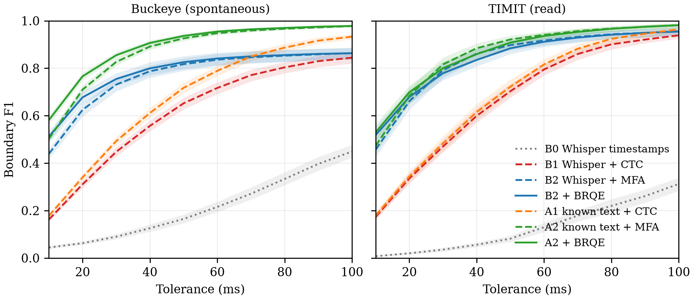

# Результаты трёх пересчётов по образцу FA-Bench

> **Поправка 24.11.2026.** Вывод «потери B — это потери распознавания, а не выравнивания» и фраза «B2 и A2 одинаково точны» в разделах 1 и 5 неверны. Сравнение recall шло по разным наборам границ, а MAE группы M2I (26,1 против 19,0 мс) было упущено. На одних и тех же границах Buckeye (n = 13 570): recall@20 A2 0,745, B2 0,728; MAE 17,6 и 26,1 мс; A лучше по MAE у 19 из 20 дикторов. На TIMIT разницы нет. Расчёт добавлен после чисел, без протокола: `reports/claim117_recheck_20261124/`. «Концы речевых отрезков» — это края вырезанных клипов; в начале клипов TIMIT BRQE снижает долю промахов, но MAE растёт (29,0 → 38,6 мс, B). Независимая проверка подтвердила арифметику, а не толкование.

Выполнено 23.11.2026 по протоколу `docs/FA_EXTRAS_PROTOCOL.md` (коммит `2cdc3aa`, записан до чисел). Код — `scripts/fa_extras.py`, тесты — `tests/test_fa_extras.py`, рисунок — `scripts/render_fa_extras.py`. Архив — `reports/fa_extras_20261123/` (`fa_extras.json`, `f1_tolerance_en.pdf/png`), дерево чистое, ревизия `49acdc5`; расчёт занял 29 с. Модели не запускались.

Анализы описательные. Frozen-числа и CLAIM не менялись.

**Проверки корректности пройдены.** F1@20 и F1@50 совпали с `reports/f1_20261123/f1_results.json` (до 1e-9). Средние знаковые ошибки начала и конца всех 9 режимов совпали с `reports/e1_analysis_20261102/analysis.json` (до 0,01 мс) на обоих корпусах.

## 1. Где сценарий B теряет точность: группы границ (Buckeye)

Формат ячейки: доля эталонных границ / recall@20 в группе / MAE (мс) по границам со своим сопоставленным словом.
- M2I — внутренняя граница, оба соседних слова распознаны;
- M1I — внутренняя граница, распознано одно из двух слов;
- M1B / M1E — начало первого / конец последнего слова клипа, слово распознано.

Группы M0 (слово не распознано) имеют recall 0 по определению; их доля в B2 4,3 %, в A2 0,3 %.

| Режим | M2I | M1I | M1B | M1E |
|---|---|---|---|---|
| B0 Whisper | 0,739 / 0,047 / 116,0 | 0,118 / 0,022 / 175,2 | 0,045 / 0,530 / 86,6 | 0,044 / 0,002 / 277,9 |
| B1 Whisper + CTC | 0,741 / 0,373 / 36,5 | 0,117 / 0,138 / 69,6 | 0,045 / 0,140 / 56,2 | 0,044 / 0,142 / 67,9 |
| B2 Whisper + MFA | 0,741 / 0,728 / 26,1 | 0,117 / 0,232 / 87,0 | 0,045 / 0,638 / 21,6 | 0,044 / 0,413 / 31,6 |
| B2 + BRQE | 0,741 / 0,770 / 24,0 | 0,117 / 0,246 / 85,9 | 0,045 / 0,742 / 17,1 | 0,044 / 0,746 / 22,2 |
| A1 CTC | 0,891 / 0,363 / 37,8 | 0,000 / — / — | 0,054 / 0,151 / 57,7 | 0,054 / 0,149 / 67,1 |
| A2 MFA | 0,887 / 0,731 / 19,0 | 0,000 / — / — | 0,054 / 0,652 / 20,9 | 0,054 / 0,442 / 27,6 |
| A2 + BRQE | 0,887 / 0,770 / 16,9 | 0,000 / — / — | 0,054 / 0,741 / 17,2 | 0,054 / 0,759 / 18,6 |

Разница вкладов групп (доля × recall) в общий recall@20:
- **A2 − B2: +0,095.** Группа M2I даёт +0,110, M1I даёт −0,027, края +0,012. Внутри M2I recall почти одинаков: 0,731 у A2 и 0,728 у B2. Значит, B проигрывает не потому, что хуже ставит границы распознанных слов, а потому, что у него меньше границ с обоими распознанными соседями: 74 % против 89 %. На границе рядом с ошибкой распознавания (M1I) MAE B2 равен 87 мс, а recall 0,23. Вывод: **потери сценария B — это потери распознавания, а не выравнивания.** С BRQE картина та же (+0,099).
- **Края клипа.** Конец последнего слова — самая трудная граница: у A2 recall 0,44 против 0,73 внутри. Это совпадает с выводом FA-Bench о том, что концы высказываний труднее.
- **Откуда выигрыш BRQE.** У B2 BRQE прибавляет +0,052: из них +0,031 на M2I и +0,020 на краях (M1E +0,015, M1B +0,005), хотя края — всего 9 % границ. У A2 картина та же: +0,056, из них +0,034 и +0,022. На краях BRQE поднимает recall конца клипа с 0,41–0,44 до 0,75–0,76.

## 2. TIMIT: группы коротко

- **A против B:** +0,022, почти всё за счёт доли M2I (89 % против 85 %); recall внутри M2I одинаков (0,739 против 0,736).
- **BRQE против MFA:** +0,018 (B) и +0,015 (A), и **почти весь выигрыш на краях клипа.** Внутри (M2I) разница 0,002 и −0,001. То есть на читаемой речи BRQE исправляет только края, а внутренние границы не улучшает. Это уточняет CLAIM-104 об отсутствии переноса.

## 3. F1 при допусках от 10 до 100 мс

| F1 (Buckeye) | 10 | 20 | 30 | 40 | 50 | 70 | 100 мс |
|---|---:|---:|---:|---:|---:|---:|---:|
| B0 Whisper | 0,044 | 0,063 | 0,090 | 0,126 | 0,165 | 0,271 | 0,449 |
| B1 Whisper + CTC | 0,162 | 0,311 | 0,448 | 0,557 | 0,652 | 0,771 | 0,844 |
| B2 Whisper + MFA | 0,439 | 0,624 | 0,731 | 0,787 | 0,817 | 0,846 | 0,864 |
| B2 + BRQE | 0,512 | 0,677 | 0,755 | 0,799 | 0,826 | 0,850 | 0,863 |
| A1 CTC | 0,178 | 0,340 | 0,493 | 0,611 | 0,717 | 0,850 | 0,933 |
| A2 MFA | 0,502 | 0,710 | 0,827 | 0,891 | 0,926 | 0,959 | 0,978 |
| A2 + BRQE | 0,582 | 0,766 | 0,855 | 0,907 | 0,936 | 0,964 | 0,978 |

- **BRQE на Buckeye** выигрывает больше всего при малых допусках: +0,07–0,08 при 10 мс. К 100 мс выигрыш исчезает (0,863 против 0,864 в B; 0,978 и 0,978 в A). Хуже MFA BRQE на Buckeye не становится ни при каком допуске; при 100 мс в B разница −0,001 — это ничья.
- **BRQE на TIMIT** лучше MFA только при 10–20 мс. Начиная с 30 мс он хуже: в B 0,779 против 0,792, в A 0,800 против 0,816; при 40–50 мс разница 0,01–0,03. Отрицательный перенос на читаемую речь проявляется на допусках от 30 мс.
- **Потолок сценария B.** На Buckeye F1 B2 выходит на плато около 0,86, потому что пропущенные и неверно распознанные слова не исправит никакой допуск. **Начиная с 70 мс CTC с известным текстом (A1) обгоняет Whisper + MFA (B2):** 0,850 против 0,846, при 100 мс 0,933 против 0,864. При грубом допуске знание текста важнее точного выравнивателя. На TIMIT, где Whisper ошибается редко, такого пересечения нет.
- **MFA и CTC** к 100 мс почти сходятся при известном тексте (0,978 против 0,933 на Buckeye, 0,982 против 0,964 на TIMIT). Основное различие — в диапазоне 10–50 мс.

## 4. Знаковые ошибки и длительность слов

Знак: предсказание минус эталон, мс; в скобках — интервал бутстрепа по дикторам.

| Режим | Buckeye: начало | конец | длительность | \|длит.\| | MAE | TIMIT: начало | конец | длит. | \|длит.\| | MAE |
|---|---:|---:|---:|---:|---:|---:|---:|---:|---:|---:|
| B0 Whisper | −115,0 [−121,7; −108,1] | −136,3 | −21,3 | 86,4 | 126,5 | −147,5 [−156,2; −139,8] | −157,8 | −10,3 | 101,2 | 153,0 |
| B1 Whisper + CTC | +43,2 [40,3; 46,3] | −15,0 | −58,2 | 65,8 | 41,3 | +39,0 | −23,3 | −62,3 | 66,6 | 36,9 |
| B2 Whisper + MFA | −5,2 | −2,3 | +2,8 | 33,8 | 30,1 | −5,6 | +1,9 | +7,5 | 30,3 | 20,5 |
| B2 + BRQE | −8,0 | −3,6 | +4,4 | 30,6 | 27,7 | −8,7 | −1,6 | +7,1 | 29,7 | 20,1 |
| A1 CTC | +45,6 [43,1; 48,4] | −14,8 | −60,4 | 66,2 | 40,5 | +38,8 | −23,1 | −61,9 | 66,5 | 36,9 |
| A2 MFA | +6,3 | +2,1 | −4,3 | 28,1 | 19,6 | −6,2 | +1,7 | +7,8 | 30,2 | 20,3 |
| A2 + BRQE | +3,7 | +1,0 | −2,7 | 24,6 | 17,0 | −9,1 | −1,5 | +7,6 | 29,5 | 19,9 |

- **Whisper.** Слова сдвинуты целиком: начало на 115 мс раньше на Buckeye и на 148 мс раньше на TIMIT, конец на 136 и 158 мс раньше. Средняя ошибка длительности при этом мала: −21 и −10 мс. Это подтверждает наблюдение FA-Bench (сдвиг около 150 мс, длительность верна до 16 мс); наш сдвиг начала на TIMIT, −148 мс, почти совпадает с их −150 мс. Но **для отдельного слова длительность неточна:** |ошибка| 86–101 мс. Она меньше MAE (127–153 мс), но не на порядок. Поэтому одна константа исправила бы среднее, но не каждое слово.
- **CTC.** Начинает слово на 39–46 мс позже и заканчивает на 15–23 мс раньше, так что слова короче примерно на 60 мс. Это согласуется с Zolkepli (2026): первый кадр символа в среднем на 33 мс позже начала слова, внутри слова много кадров пустого символа.
- **MFA.** Сдвиги малые, от −6 до +6 мс, длительность верна в среднем до 8 мс. Поэтому константа почти ничего не даёт: CLAIM-103, константа — слабый соперник. BRQE уменьшает именно разброс (|длительность| 28,1 → 24,6 мс в A2), а не средний сдвиг.

## 5. Что из этого в статью (решает автор)

1. **Одно предложение в RQ1.** Потери сценария B на Buckeye почти целиком идут от границ, рядом с которыми распознано не всё. На границах между двумя распознанными словами точность B2 и A2 одинакова (recall@20 0,728 против 0,731).
2. **Одно предложение в RQ2.** Около 40 % выигрыша BRQE на Buckeye приходится на края клипов (9 % границ); на TIMIT — почти весь выигрыш. Это честное уточнение: BRQE особенно исправляет концы речевых отрезков.
3. **Рисунок F1 от допуска** может заменить ECDF. На нём видны три вещи: выигрыш BRQE при малых допусках, потолок сценария B и отрицательный перенос на TIMIT от 30 мс.
4. **В обсуждение.** Whisper сдвигает слова целиком (у нас −148 мс на TIMIT, у FA-Bench −150 мс), CTC запаздывает с началом слова. Оба наблюдения согласуются с литературой.

## 6. Независимая проверка

Субагент заново реализовал все три анализа только по протоколам (`FA_EXTRAS_PROTOCOL.md`, `F1_PROTOCOL.md`), не открывая `scripts/fa_extras.py` и его тесты (`reports/fa_extras_20261123/independent/`). **Совпали все 1620 сравнённых значений** (допуск 1e-6):
- группы: доли, recall, MAE;
- F1, precision, recall и интервалы при всех 10 допусках;
- знаковые средние с интервалами, |длительность|, MAE;
- число упавших клипов.

Неоднозначности, которые он отметил, решены так же, как в коде:
- у клипа из одного слова начало относится к группе B, конец — к E;
- допуск включает `BOUNDARY_EPSILON_MS`;
- выборка бутстрепа без предсказанных границ получает precision 0;
- MAE группы без сопоставленных слов не определён;
- |длительность| усредняется по словам, MAE — по границам начала и конца вместе.

Его качественные выводы совпадают с разделами 1–4. Одна оговорка: он пишет, что на Buckeye BRQE впереди при всех допусках, но при 100 мс в B у него тоже 0,863 против 0,864, то есть ничья, как и сказано в разделе 3.
