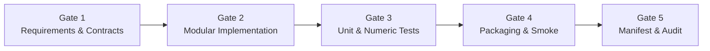

# Software Development Life Cycle (SDLC) & Quality Framework
**Project:** Local Subtitle Alignment Workbench  
**Methodology Origin:** Applied Software Development Practice (ASDP) Engineering Standard  
**Author:** Askar Nurym  
**Target Repository:** `local-subtitle-workbench`  
**Status:** Active Process Specification

---

## 1. SDLC Philosophy & Principles

The development of the Local Subtitle Alignment Workbench follows an incremental, test-driven, and contract-first Software Development Life Cycle (SDLC) adapted from the ASDP engineering standards.

Every increment represents a verified, functional addition to the repository. The process guarantees that:
- Code is accompanied by automated numerical oracles and contract tests.
- Scientific claims are backed by executable code and immutable data manifests.
- Dependencies are pinned and locked (`uv.lock`).
- Zero regressions are tolerated across releases.

---

## 2. The 5 Quality Gates



| Gate | Focus | Verification Evidence | Acceptance Criteria |
| :--- | :--- | :--- | :--- |
| **Gate 1: Requirements & Contracts** | Data models, input limits, error modes | Typed dataclasses in `models.py` with explicit boundary validation | Validated finite numbers, ASCII IDs, explicit error messages (exit code 2). |
| **Gate 2: Modular Implementation** | Single-responsibility components | Python source code in `src/subtitle_workbench/` | Strict typing (`mypy`-compliant), zero circular imports, isolated modules. |
| **Gate 3: Unit & Numeric Tests** | Correctness, mathematical bounds | `pytest` test suite and `ruff` linter | 100% tests pass; zero linting warnings; exact numerical tolerance checks. |
| **Gate 4: Packaging & Smoke** | Distributability & offline safety | Wheel build (`hatchling`) and isolated venv smoke run | Wheel builds cleanly; smoke test runs with network sockets blocked. |
| **Gate 5: Manifest & Audit** | Scientific reproducibility | `manifest.json` generation | Valid SHA-256 for all inputs, outputs, and code provenance. |

---

## 3. Definition of Done (DoD) for Increments

An increment or feature pull request is considered **Done** if and only if it satisfies all of the following conditions:

1. **Contract Enforcement:** All public functions and classes declare strict type annotations and validate inputs (rejecting `NaN`, `inf`, `bool` passed as numbers, negative times, and out-of-bounds indices).
2. **Automated Unit Tests:** Unit tests in `tests/` cover:
   - Standard execution with controlled fixtures.
   - Edge cases (minimum duration, boundary points, empty/large inputs).
   - Negative cases (invalid formats, corrupt audio, corrupted cue JSON).
3. **Zero Regression:** All existing test suites pass without modification (or with explicitly justified contract updates).
4. **Code Quality & Formatting:**
   - `uv run --locked ruff check .` passes with zero errors.
   - `uv run --locked ruff format --check .` passes with zero formatting diffs.
5. **Documentation Synchronized:** The relevant technical documentation in `docs/` is updated to reflect the new API, parameters, or behavioral constraints.
6. **Deterministic Wheel Build:** `uv run --locked python -m build --wheel --no-isolation` succeeds.
7. **Conventional Git Commit:** Commit messages follow the Conventional Commits format:
   - `feat(scope): ...` for new features
   - `fix(scope): ...` for bug fixes
   - `test(scope): ...` for test additions
   - `docs(scope): ...` for documentation
   - `refactor(scope): ...` for architectural restructuring

---

## 4. Incremental Delivery Roadmap

```
                                  INCREMENTAL DELIVERY ROADMAP
┌────────────────────────────────────────────────────────────────────────────────────────┐
│ Increment 0: Planning & Foundations (CURRENT)                                         │
│ • Architecture, Knowledge Base, Corpora Taxonomy, Analogs Backlog, Anti-Falsification │
│ • SDLC Process and Agentic Rules established                                          │
├────────────────────────────────────────────────────────────────────────────────────────┤
│ Increment 1: Text Normalization & Speech Contracts                                     │
│ • Word-span token mapping (text_norm.py) handling contractions, numbers, and casing   │
│ • ASRSegment, WordToken, PhonemeCue typed data models in models.py                    │
├────────────────────────────────────────────────────────────────────────────────────────┤
│ Increment 2: ASR & Silence Detection                                                   │
│ • Faster-Whisper Large-v3 INT8 integration (asr.py) with Silero-VAD                   │
│ • Sequential VRAM unloading mechanism (torch.cuda.empty_cache)                         │
├────────────────────────────────────────────────────────────────────────────────────────┤
│ Increment 3: Macro-DTW Bounded Chunking                                                │
│ • Bounded chunk partitioner (L <= 30s) with 0.5s overlap padding                       │
│ • Long-form drift compensation integrating dtw.py                                      │
├────────────────────────────────────────────────────────────────────────────────────────┤
│ Increment 4: Micro Forced Alignment Engines                                            │
│ • Montreal Forced Aligner adapter (mfa_wrapper.py) for Kaldi HMM-GMM (<20ms target)   │
│ • TorchAudio MMS_FA CTC-Trellis in-process fallback (ctc_aligner.py)                   │
├────────────────────────────────────────────────────────────────────────────────────────┤
│ Increment 5: Standardized Bimodal Exporters                                            │
│ • Karaoke-tagged WebVTT (<c> tags) and schema.org VideoObject/Clip JSON-LD             │
│ • Raw scientific alignment exporter (alignment_raw.json)                              │
├────────────────────────────────────────────────────────────────────────────────────────┤
│ Increment 6: Automated Empirical Benchmark Suite                                       │
│ • scripts/speech_benchmark.py evaluating TIMIT, Buckeye, and Prototype audio          │
│ • Automated Clustered Bootstrap (B=2000) and Paired Wilcoxon significance tests        │
└────────────────────────────────────────────────────────────────────────────────────────┘
```

---

## 5. Security, Packaging & Offline Guards

1. **Zero Credential Rule:** No API keys, cloud tokens, `.env` files, or proprietary credentials may ever be committed to the repository. The entire pipeline runs 100% locally on the user's workstation.
2. **Offline Network Guard:** Packaging smoke tests (`scripts/smoke_wheel.py`) enforce an explicit socket block (`socket.socket = disabled_socket`) to guarantee that the workbench functions entirely offline without hidden model downloads or telemetry calls.
3. **Weight & Data Storage:** Large pretrained model weights (HuggingFace, CTranslate2, MFA acoustic models) and raw speech corpora are stored in user cache directories (`~/.cache/`) and referenced via local paths; they are strictly excluded from Git tracking via `.gitignore`.

---

## 6. Increment Logging & Audit Reporting Protocol

To maintain complete transparency, traceability, and defensibility of every development step for the Master's Thesis and course assignments, every completed increment must produce a dedicated, standardized markdown report.

1. **Storage Location:** All increment reports are stored strictly in `docs/increments/`.
2. **Naming Convention:** `INCREMENT_<N>_<UPPERCASE_NAME>.md` (e.g., `INCREMENT_1_SPEECH_MODELS_AND_NORM.md`).
3. **Template Standard:** Each report must follow [`docs/increments/TEMPLATE_INCREMENT_REPORT.md`](file:///C:/Users/nurym/Desktop/local-subtitle-workbench/docs/increments/TEMPLATE_INCREMENT_REPORT.md).
4. **Mandatory Report Sections:**
   - Increment ID, Date, Branch, Commit SHA, Author, and Status.
   - Executive Summary & Problem Solved.
   - Traceability to Master's Individual Plan (НИРМ milestones) and ASDP Quality Gates.
   - Exact Inventory of Changes: files created, modified, lines of code, and architectural responsibilities.
   - Quality Gate Verification Evidence: full console outputs of `pytest`, `ruff check`, and wheel build.
   - Architectural Decisions & Trade-Offs Made.
   - Edge Cases and Boundary Conditions Tested.
   - Handover notes and prerequisites for the subsequent increment.
5. **Git Policy:** The increment report must be committed to the feature branch alongside the implementation code before the pull request or merge into `main` is approved.
